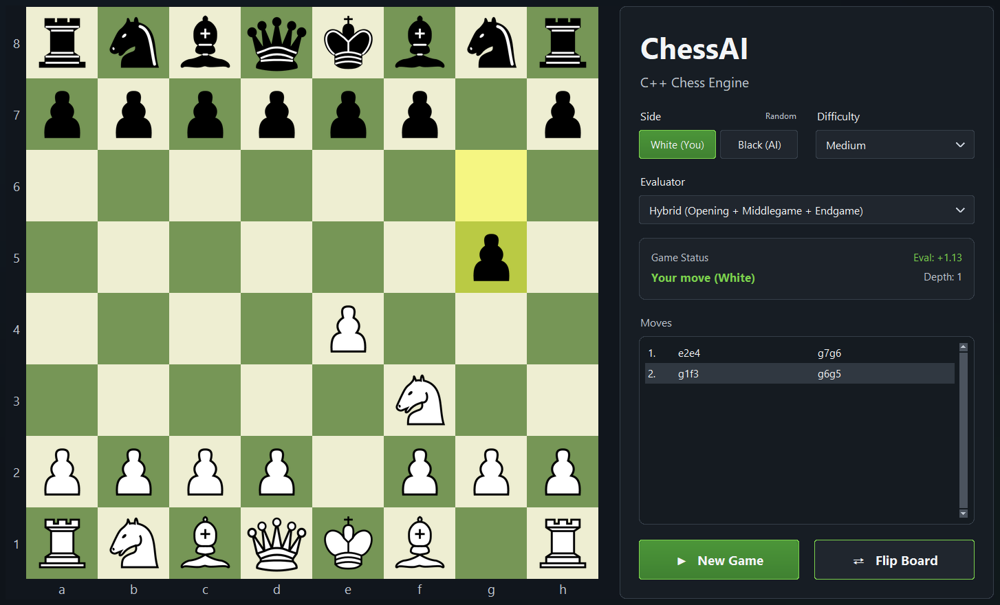
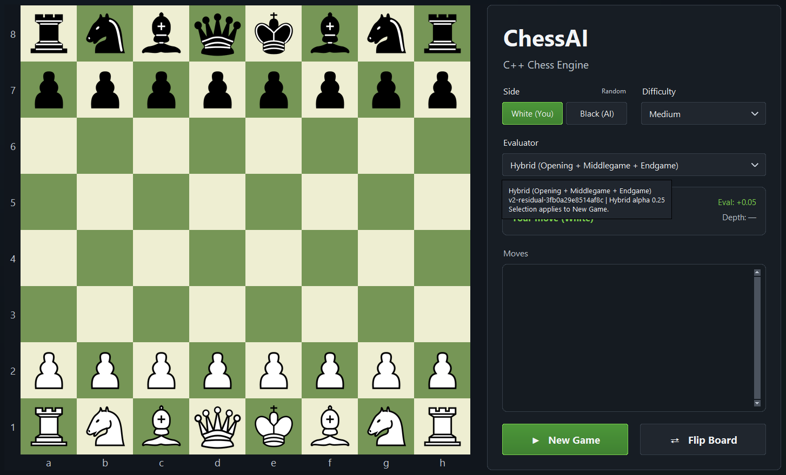
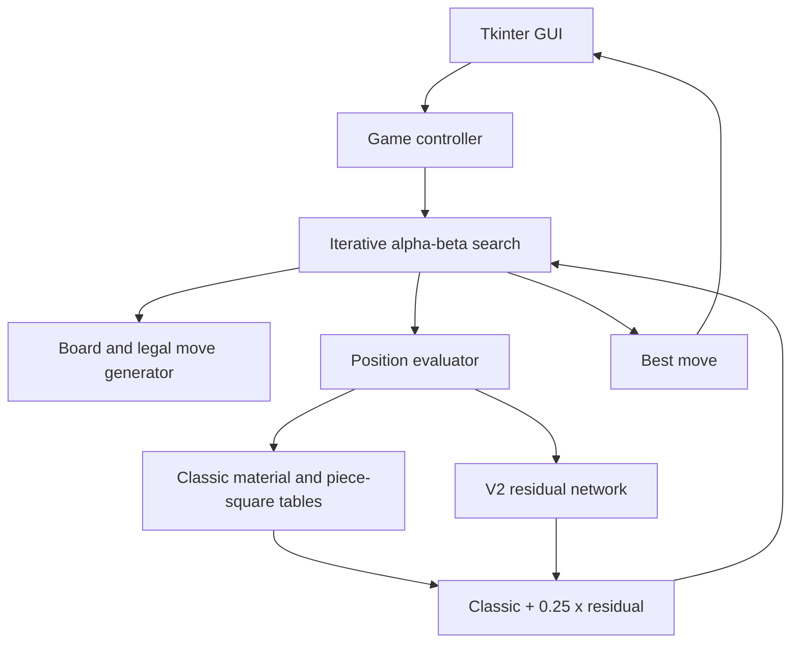

# ChessAI

A chess engine built from scratch in C++17, combining alpha-beta search with a trained neural residual evaluator and optimized native inference. Play through a Python/Tkinter desktop GUI, or inspect the reproducible evaluation and calibration evidence. **v1.0.0** preserves the frozen production engine.

## Demo





## Highlights

- Legal move generation including castling, en passant and promotion, validated with perft.
- Alpha-beta, iterative deepening, quiescence, move ordering and Zobrist transposition tables.
- Classic handcrafted, Direct ML and production Hybrid V2 evaluators.
- Offline PyTorch training and native C++ deployment without a production PyTorch dependency.
- Runtime-checked AVX2 fused tail and sparse active-index first layer, with portable reference fallback.
- Desktop GUI, paired-opening tournaments, frozen test protocols and external Stockfish calibration.

## Architecture



See [module boundaries and data flow](docs/ARCHITECTURE.md).

## Search engine

Alpha-beta prunes branches that cannot improve the current bound. Iterative deepening retains a completed result under a time budget. Zobrist keys index a transposition table to reuse bounds and moves. Move ordering seeks useful moves early; quiescence extends tactical leaf positions before trusting a static score. Mate scores encode distance, favoring earlier wins and postponing losses. Game handling distinguishes checkmate, stalemate, repetition, the fifty-move rule and insufficient material.

This is an independent implementation, not a Stockfish-derived search architecture.

## ML evaluation

Approximately 250,000 Stockfish-labelled positions from Lichess evaluation data support offline training and evaluation. V2 uses 789 features and 128/64 hidden units. The residual model learns a correction to Classic:

`Hybrid = round(clip(Classic + 0.25 * residual, -1500, 1500))`

Production model: **`v2-residual-3fb0a29e8514af8c`**. Alpha is frozen at **0.25**. PyTorch runs offline; generated weight headers and manual C++ inference run the model in production.

**Lower offline prediction error did not automatically translate into stronger play.** Development and held-out validation matches informed alpha selection before the frozen final evaluation. No new alpha values were tuned on the final suite. [ML development and deployment](docs/ML_EVALUATION.md) explains the feature contract and limitations.

## Performance

Recorded Release measurements on an AMD Ryzen 7 3700X:

| Residual Hybrid implementation | Microseconds/evaluation | Evaluations/second |
|---|---:|---:|
| Reference | 7.563 | 132,231 |
| Optimized production | 3.031 | 329,902 |

Approximately **59.9% lower latency** and **2.50x throughput**, using an AVX2 fused tail and sparse active-index Linear1. Runtime CPU/OS checks retain the reference fallback. All 250,000 residuals remained bit-identical and no rounded Hybrid score changed. Fixed-depth search behavior was preserved. Timings depend on hardware and workload; see [measurements and controls](benchmarks/V2_OPTIMIZATION.md).

## Playing strength

Frozen external calibration: Stockfish 19, one thread, 64 MiB hash, 250 ms/move, 64 held-out opening positions with reversed colors, 128 games per level (512 total).

| Stockfish UCI_Elo | ChessAI W / D / L | ChessAI score |
|---:|---:|---:|
| 1520 | 78 / 18 / 32 | 67.97% |
| 1620 | 58 / 19 / 51 | 52.73% |
| 1720 | 46 / 24 / 58 | 45.31% |
| 1820 | 34 / 13 / 81 | 31.64% |

**Observed Stockfish 19 UCI_Elo crossing of approximately 1657 at 250 ms/move under the frozen calibration protocol.** This is protocol-specific and is **not** a FIDE, Chess.com or Lichess Elo rating. Opening-cluster bootstrap uncertainty prevented a sufficiently stable 95% calibrated point estimate; the report intentionally leaves the estimate and interval unset. [Frozen calibration report](benchmarks/elo/final_results.md).

## Validation

| Perft position | Depth 1 | Depth 2 | Depth 3 | Depth 4 | Depth 5 |
|---|---:|---:|---:|---:|---:|
| Starting position | 20 | 400 | 8,902 | 197,281 | 4,865,609 |
| Kiwipete | 48 | 2,039 | 97,862 | 4,085,603 | - |

Regression checks cover move generation, evaluation, search, game rules, evaluator overrides, opening manifests, GUI defaults and protocols. Python/C++ features match exactly; neural prediction parity uses a numerical tolerance. Optimized/reference C++ residual parity is bit-exact across 250k positions. These are distinct checks, not claims of bit-exact PyTorch arithmetic. [Benchmark methodology](docs/BENCHMARKS.md).

## GUI

The dark desktop interface includes legal move indicators, a scrollable two-column move history, promotion selection and an independent Flip Board control. Side, difficulty and evaluator selections apply when starting a New Game. Hybrid V2 is selected by default. Medium uses the existing Casual profile; difficulty labels are gameplay modes, **not independently calibrated human Elo ratings**. Eval shows the current White-relative static score in pawns, while Depth comes from the last engine search. Hover over the status card for search details or the evaluator control for the model and alpha.

## Build and run (Windows)

Install Visual Studio with Desktop development with C++, CMake 3.16+ and Python 3.9+ with Tkinter. From the repository root in a Visual Studio developer shell:

```powershell
cmake -S . -B build -A x64
cmake --build build --config Release --parallel 4
python -m pip install Pillow
python src/gui/gui.py
```

The GUI expects `build/Release/ChessAI.exe` (with Debug as a fallback). Alternatively, double-click **`run_chessai.bat`**, which finds Python and sets the working directory. Pillow improves image handling; Tk image fallback is available. Keep `src/gui/assets/` and the generated production weight headers in the checkout. Stockfish and PyTorch are not needed to play.

## Tests

```powershell
Push-Location build
ctest -C Release --output-on-failure
Pop-Location
python tests/tournament_smoke.py
python tests/test_opening_manifests.py
python tests/gui_defaults_test.py
python ml/test_protocol.py --engine build/Release/ChessAI.exe
```

[Release checks](docs/RELEASE_CHECK.md) lists the full regression commands and optional full-corpus parity dependencies. Do not rerun frozen strength experiments as a release check.

## Repository layout

```text
src/          C++ board, search, evaluators, game controller, benchmarks and GUI
ml/           Offline preparation, training, export and feature schemas
benchmarks/   Protocols, opening suites, measurements and calibration evidence
tests/       Native and Python regression checks
docs/        Architecture, ML, benchmarks and release notes
```

## Methodology and limitations

Curated opening suites and paired colors reduce some sources of bias but do not represent every chess position. Opening-cluster intervals retain paired games together. External results depend on opponent version, strength-limited mode, 250 ms time control and hardware. A fixed harness seed does not control Stockfish internal randomness. Timed results vary. Fixed-depth and timed experiments answer different questions and should not be pooled. Historical reports retain their original provenance and chronology.

## Project context

An independent engineering project spanning C++, algorithms, machine learning, model deployment, CPU optimization and reproducible benchmarking. See the [release audit](docs/RELEASE_AUDIT.md) for inclusion decisions and remaining publication checks.

## License and asset notices

ChessAI source code is licensed under [MIT](LICENSE). The bundled Livius chess
pieces are public-domain artwork by Martin Sedl?k, under their own dedication.
The project MIT license does not override third-party asset licenses. See
[third-party notices](THIRD_PARTY_NOTICES.md) for the exact source, revision and
license, and the [publication audit](docs/PUBLICATION_AUDIT.md) for release checks.
